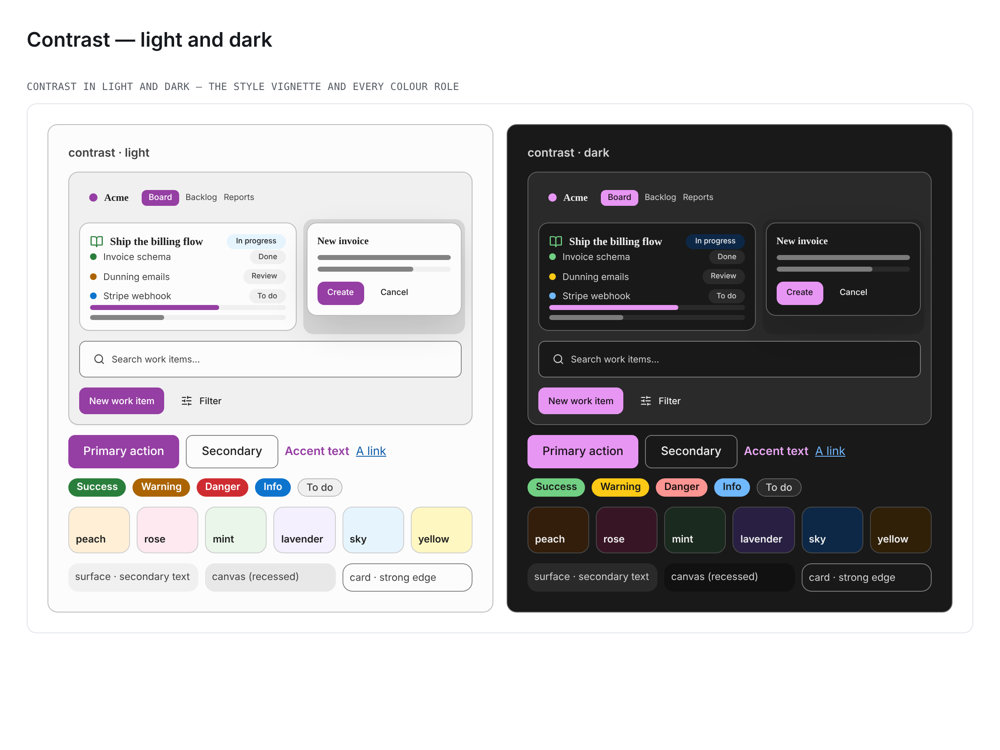

# Palette — Contrast (`data-palette="contrast"`)

> A **high-contrast** neutral re-skin for reading without strain (low vision, a bright
> room, a tired projector): paper-white grounds, near-black ink, secondary copy at **AAA
> (7:1)** rather than AA, and control edges strong enough to see (**3:1**, WCAG 1.4.11).
> Registered in
> [`packages/design-system/src/theme/palettes.ts`](../../packages/design-system/src/theme/palettes.ts);
> its override lives in the **AXIS 1 (COLOUR)** section of
> [`packages/design-system/theme.css`](../../packages/design-system/theme.css) (which
> `app/globals.css` imports) as the `[data-palette='contrast']` light block plus a dark
> companion selected by both
> `[data-theme='dark'] [data-palette='contrast']:not([data-theme])` and
> `[data-palette='contrast'][data-theme='dark']`.

**Tagline:** Clear and strong — paper-white grounds, near-black ink, AAA secondary text and
edges you can see.
**Inspiration:** A **high-contrast reading scheme**, not a brand — so, as
[Candy](candy.md) does, **every value is a documented
[Radix Colors](https://www.radix-ui.com/colors) step** (`@radix-ui/colors@3.0.0`). The
neutrals are **one** ramp, **Gray**, with the text roles at the steps Radix designs for
text (11 low-contrast, 12 high-contrast); **Plum** is the primary, **Orange** the
highlight, the tints are step-3 pastels of **Orange / Crimson / Grass / Violet / Blue /
Amber**, and **Grass / Amber / Red / Blue** carry the semantics.

This is the COLOUR (palette) axis only — picking Contrast never changes a radius, a
spacing, a shadow or a font (the independent `data-style` and `data-type` axes; the
High-Contrast / Accessible _style_ is a separate choice and composes with it).

## How it re-skins

Contrast overrides the Tier-0 `--color-*` sources the `--el-*` element layer reads, so
every element token follows; the one element token it sets directly is
`--el-sidebar-item-bg-hover`, declared in **both** modes. It sets colour tokens only
(`tests/theme/paletteRegistry.test.ts` enforces the disjointness).

## Where the palette differs from `motir` — two measured ratios

`motir` is already neutral, so the difference is not hue. It is two ratios against the
ground. [`docs/palettes/motir.md`](motir.md) records `motir`'s own secondary text on its
section surface at **5.9:1** light and **7.8:1** dark — AA in both modes, AAA in only one.
Measured in the same run as the 7:1 criterion below:

| Role, ground                            | mode  | Contrast  | `motir` |
| --------------------------------------- | ----- | --------- | ------- |
| `--el-text-secondary` on `--el-surface` | light | **8.82**  | 5.91    |
| `--el-text-secondary` on `--el-surface` | dark  | **9.40**  | 7.81    |
| `--el-text-secondary` on `--el-card`    | light | **9.80**  | 6.75    |
| `--el-text-secondary` on `--el-card`    | dark  | **11.51** | 8.64    |
| `--el-border-strong` on `--el-card`     | light | **3.70**  | 1.61    |
| `--el-border-strong` on `--el-card`     | dark  | **4.15**  | 1.78    |

So Contrast's secondary clears 7:1 in **both** modes, and its strong edge clears 3:1 where
`motir`'s is a hairline at about 1.6–1.8:1.

## The derived step, and the lighter tints

Gray-11 `#646464` is Radix's low-contrast text step, and on the white page it is 5.9:1 —
AA, not AAA. So secondary text takes **Gray-11 mixed 50% toward Gray-12** (`#424242`
light, `#d1d1d1` dark), a value derived from the two text steps of the same ramp rather
than an invented grey; it keeps a visible step below the Gray-12 primary ink. The link
takes [Lagoon](lagoon.md)'s **Blue-11 → Blue-12, 65%** step (`#0e5da9`), because Blue-11
alone is under AA on the Gray-4 canvas.

The tints use **step 3** rather than the step-4 convention: where 7:1 body ink collides
with a wash that must still read as a tint, the TINT moves lighter, as
[Candy](candy.md) records for its own accent-on-tint collision. In dark, step 3 is the
deeper wash, for the same reason.

## Every value and the step behind it

| Token                            | Light     | Radix step (light)     | Dark      | Radix step (dark)           |
| -------------------------------- | --------- | ---------------------- | --------- | --------------------------- |
| `--color-primary`                | `#953ea3` | Plum-11                | `#e796f3` | Plum dark-11                |
| `--color-primary-foreground`     | `#ffffff` | white label            | `#181118` | Plum dark-1                 |
| `--color-primary-pressed`        | `#53195d` | Plum-12                | `#b658c4` | Plum dark-10                |
| `--color-primary-fill`           | `#953ea3` | Plum-11                | `#e796f3` | Plum dark-11                |
| `--color-background`             | `#fcfcfc` | Gray-1                 | `#191919` | Gray dark-2                 |
| `--color-foreground`             | `#202020` | Gray-12                | `#eeeeee` | Gray dark-12                |
| `--color-surface`                | `#f0f0f0` | Gray-3                 | `#2a2a2a` | Gray dark-4                 |
| `--color-surface-soft`           | `#f9f9f9` | Gray-2                 | `#222222` | Gray dark-3                 |
| `--color-canvas`                 | `#e8e8e8` | Gray-4                 | `#111111` | Gray dark-1                 |
| `--color-ink`                    | `#202020` | Gray-12                | `#eeeeee` | Gray dark-12                |
| `--color-charcoal`               | `#202020` | Gray-12                | `#eeeeee` | Gray dark-12                |
| `--color-slate`                  | `#424242` | Gray-11 → Gray-12, 50% | `#d1d1d1` | Gray dark-11 → dark-12, 50% |
| `--color-steel`                  | `#646464` | Gray-11                | `#b4b4b4` | Gray dark-11                |
| `--color-stone`                  | `#8d8d8d` | Gray-9                 | `#6e6e6e` | Gray dark-9                 |
| `--color-muted`                  | `#f0f0f0` | Gray-3                 | `#2a2a2a` | Gray dark-4                 |
| `--color-muted-foreground`       | `#646464` | Gray-11                | `#b4b4b4` | Gray dark-11                |
| `--color-hairline`               | `#bbbbbb` | Gray-8                 | `#606060` | Gray dark-8                 |
| `--color-hairline-soft`          | `#cecece` | Gray-7                 | `#484848` | Gray dark-7                 |
| `--color-hairline-strong`        | `#838383` | Gray-10                | `#7b7b7b` | Gray dark-10                |
| `--color-border`                 | `#bbbbbb` | Gray-8                 | `#606060` | Gray dark-8                 |
| `--color-accent`                 | `#cc4e00` | Orange-11              | `#ffa057` | Orange dark-11              |
| `--color-accent-orange`          | `#ab6400` | Amber-11               | `#ffca16` | Amber dark-11               |
| `--color-accent-teal`            | `#008573` | Teal-11                | `#0bd8b6` | Teal dark-11                |
| `--color-accent-green`           | `#2a7e3b` | Grass-11               | `#71d083` | Grass dark-11               |
| `--color-tint-peach`             | `#ffefd6` | Orange-3               | `#331e0b` | Orange dark-3               |
| `--color-tint-rose`              | `#ffe9f0` | Crimson-3              | `#381525` | Crimson dark-3              |
| `--color-tint-mint`              | `#e9f6e9` | Grass-3                | `#1b2a1e` | Grass dark-3                |
| `--color-tint-lavender`          | `#f4f0fe` | Violet-3               | `#291f43` | Violet dark-3               |
| `--color-tint-sky`               | `#e6f4fe` | Blue-3                 | `#0d2847` | Blue dark-3                 |
| `--color-tint-yellow`            | `#fff7c2` | Amber-3                | `#302008` | Amber dark-3                |
| `--color-success`                | `#2a7e3b` | Grass-11               | `#71d083` | Grass dark-11               |
| `--color-warning`                | `#ab6400` | Amber-11               | `#ffca16` | Amber dark-11               |
| `--color-destructive`            | `#ce2c31` | Red-11                 | `#ff9592` | Red dark-11                 |
| `--color-destructive-foreground` | `#ffffff` | white label            | `#191111` | Red dark-1                  |
| `--color-info`                   | `#0d74ce` | Blue-11                | `#70b8ff` | Blue dark-11                |
| `--color-link`                   | `#0e5da9` | Blue-11 → Blue-12, 65% | `#70b8ff` | Blue dark-11                |
| `--color-link-pressed`           | `#113264` | Blue-12                | `#c2e6ff` | Blue dark-12                |
| `--el-sidebar-item-bg-hover`     | `#e8e8e8` | Gray-4                 | `#313131` | Gray dark-5                 |

## Colour roles

| Role group          | Contrast (light → dark)                                                                               |
| ------------------- | ----------------------------------------------------------------------------------------------------- |
| Text scale          | Gray-12 ink and emphasis `#202020`, secondary `#424242` → Gray-dark-12 `#eeeeee`, secondary `#d1d1d1` |
| Accent (CTA)        | Plum-11 fill `#953ea3` with white labels → bright Plum-dark-11 `#e796f3` with dark Plum-dark-1 labels |
| Surfaces            | Gray-1 page, Gray-2 / Gray-3 surfaces → Gray-dark-2 page, Gray-dark-3 / -4 surfaces                   |
| Recessed canvas     | Gray-4 `#e8e8e8`, under the Gray-3 surface → Gray-dark-1 `#111111`, under the Gray-dark-2 page        |
| Borders             | soft Gray-7 < default Gray-8 < strong Gray-10 → dark-7 < dark-8 < dark-10                             |
| Highlight and links | Orange-11 highlight; Blue links, apart from the Plum primary                                          |
| Semantics           | Grass success, Amber warning, Red danger, Blue info — Radix step 11, dark-11 in dark                  |
| Pastel tints        | step-3 washes: Orange, Crimson, Grass, Violet, Blue, Amber                                            |

**Fill versus label.** In light the **fill** carries the dark value with a white label
(**6.01:1**); in dark the fill is the bright Plum-dark-11 and the **label** carries the
dark value, Plum-dark-1 (**8.88:1**). The Plum hue sits at least ΔE2000 13.8 from every
other palette's swatch (Spectrum the nearest), so the picker dots stay apart.

## Accessibility (measured)

Every ratio below was measured on resolved values with `tests/theme/colorMetrics.ts`
over the cascade `tests/theme/paletteCascade.ts` models.

**AAA body text under every style.** The style × palette × mode matrix
(`tests/theme/stylePaletteModeContrast.test.ts`) resolves every ground each registered
style paints — material composites and canvas patterns included, folded with
`flattenColorMix`. Over every `contrast` row of that matrix, the lowest ratio for each
body-text role is (the matrix's palette-scoped floor, `PALETTE_FLOORS`, holds every
one of these rows to 7:1 and the three edges below to 3:1, so a retune under either goes red):

| Role                  | light (lowest row) | dark (lowest row) |
| --------------------- | ------------------ | ----------------- |
| `--el-text`           | 12.63              | 10.42             |
| `--el-text-strong`    | 12.63              | 10.42             |
| `--el-text-secondary` | **7.79**           | **7.91**          |

Every row also clears the matrix's own 4.5:1 floor for `--el-accent-on-surface`, with no
entry in its known-failure map.

**On the palette's own grounds** (page, card, surface, surface-soft, muted, canvas,
sidebar, six tints):

| Ink, lowest ground       | light | dark  |
| ------------------------ | ----- | ----- |
| `--el-text`              | 13.30 | 12.37 |
| `--el-text-secondary`    | 8.20  | 9.40  |
| `--el-accent-on-surface` | 4.90  | 7.63  |
| `--el-link`              | 5.43  | 6.83  |

**Edges at 3:1.** `--el-border-strong`, `--el-input-border` and `--el-button-border` all
ride `--color-hairline-strong`:

| Edge on        | light | dark |
| -------------- | ----- | ---- |
| `--el-card`    | 3.70  | 4.15 |
| `--el-surface` | 3.33  | 3.39 |
| `--el-canvas`  | 3.09  | 4.46 |

- `--el-accent-on-surface` on `--el-tint-lavender` (the ink lint's accent arm) — **5.36:1**
  / **8.14:1**.
- `--el-danger-text` on `--el-danger` — **5.21:1** / **8.82:1**.
- The hairline ramp keeps its order: soft < default < strong in both modes.
- The canvas is a recess in both modes: Gray-4 under the Gray-1 page and Gray-3 surface;
  Gray-dark-1 under the Gray-dark-2 page and Gray-dark-4 surface.
- Faint and disabled text (`--el-text-faint`, Gray-9) stays exempt, exactly as the ink
  lint exempts it in every palette.
