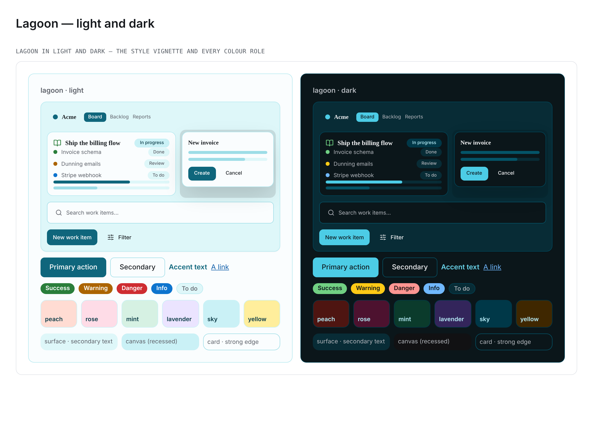

# Palette — Lagoon (`data-palette="lagoon"`)

> A cool, fresh **teal/cyan** re-skin: shallow-water cyan surfaces over cool slate
> ink, a deep lagoon-cyan primary, and a coral highlight for the reef. Registered in
> [`packages/design-system/src/theme/palettes.ts`](../../packages/design-system/src/theme/palettes.ts);
> its override lives in the **AXIS 1 (COLOUR)** section of
> [`packages/design-system/theme.css`](../../packages/design-system/theme.css) (which
> `app/globals.css` imports) as the `[data-palette='lagoon']` light block plus a dark
> companion selected by both `[data-theme='dark'] [data-palette='lagoon']:not([data-theme])`
> and `[data-palette='lagoon'][data-theme='dark']`.

**Tagline:** Cool and fresh — a deep lagoon-cyan primary over shallow-water surfaces and
slate ink, with a coral highlight.
**Inspiration:** A **lagoon concept**, not a single brand — so, exactly as
[Candy](candy.md) does, **every value is a documented
[Radix Colors](https://www.radix-ui.com/colors) step** (`@radix-ui/colors@3.0.0`):
**Cyan** is the primary ramp, **Slate** the matched cool neutral, **Tomato** the coral
highlight, and **Tomato / Crimson / Jade / Violet / Cyan / Amber** the tints, with
**Grass / Amber / Red / Blue** for the semantics.

This is the COLOUR (palette) axis only — picking Lagoon never changes a radius, a
spacing, a shadow or a font (the independent `data-style` and `data-type` axes).

## How it re-skins

Lagoon overrides the Tier-0 `--color-*` sources the `--el-*` element layer reads, so
every element token follows; the one element token it sets directly is
`--el-sidebar-item-bg-hover`, declared in **both** modes so the light value cannot
cascade into dark. It sets colour tokens only (`tests/theme/paletteRegistry.test.ts`
enforces the disjointness).

## Two derived steps, and why

Radix's step 11 is its AA "text" step, but it is tuned for a **white** ground. Lagoon's
surfaces are cyan, and on the Cyan-3 section surface Cyan-11 `#107d98` measures
**4.26:1** — under AA, and lower still on the material surfaces the styles paint
(3.73:1 on Retrofuturism's canvas). So the primary takes the move
[Candy](candy.md) records for its own Pink-11: **Cyan-11 mixed 65% toward Cyan-12**
(`#0f667c`), still derived from the two Radix steps rather than an invented darkening.
It is 5.85:1 on the surface and 6.54:1 under the white label on the fill. The link
takes the same 65% step from **Blue-11 toward Blue-12** (`#0e5da9`), because Blue-11
alone is 4.26:1 on the surface and 3.73:1 on the peach tint. Every other value is a
plain Radix step.

## Every value and the step behind it

| Token                            | Light     | Radix step (light)     | Dark      | Radix step (dark)                                     |
| -------------------------------- | --------- | ---------------------- | --------- | ----------------------------------------------------- |
| `--color-primary`                | `#0f667c` | Cyan-11 → Cyan-12, 65% | `#4ccce6` | Cyan dark-11                                          |
| `--color-primary-foreground`     | `#ffffff` | white label            | `#101b20` | Cyan dark-2                                           |
| `--color-primary-pressed`        | `#0d3c48` | Cyan-12                | `#23afd0` | Cyan dark-10                                          |
| `--color-primary-fill`           | `#0f667c` | Cyan-11 → Cyan-12, 65% | `#4ccce6` | Cyan dark-11                                          |
| `--color-background`             | `#fafdfe` | Cyan-1                 | `#0b161a` | Cyan dark-1                                           |
| `--color-foreground`             | `#1c2024` | Slate-12               | `#edeef0` | Slate dark-12                                         |
| `--color-surface`                | `#def7f9` | Cyan-3                 | `#082c36` | Cyan dark-3                                           |
| `--color-surface-soft`           | `#f2fafb` | Cyan-2                 | `#101b20` | Cyan dark-2                                           |
| `--color-canvas`                 | `#caf1f6` | Cyan-4                 | `#111113` | Slate dark-1 (Cyan has no step below its dark-1 page) |
| `--color-ink`                    | `#1c2024` | Slate-12               | `#edeef0` | Slate dark-12                                         |
| `--color-charcoal`               | `#0d3c48` | Cyan-12                | `#b6ecf7` | Cyan dark-12                                          |
| `--color-slate`                  | `#60646c` | Slate-11               | `#b0b4ba` | Slate dark-11                                         |
| `--color-steel`                  | `#60646c` | Slate-11               | `#b0b4ba` | Slate dark-11                                         |
| `--color-stone`                  | `#8b8d98` | Slate-9                | `#696e77` | Slate dark-9                                          |
| `--color-muted`                  | `#def7f9` | Cyan-3                 | `#082c36` | Cyan dark-3                                           |
| `--color-muted-foreground`       | `#60646c` | Slate-11               | `#b0b4ba` | Slate dark-11                                         |
| `--color-hairline`               | `#b5e9f0` | Cyan-5                 | `#004558` | Cyan dark-5                                           |
| `--color-hairline-soft`          | `#caf1f6` | Cyan-4                 | `#003848` | Cyan dark-4                                           |
| `--color-hairline-strong`        | `#9ddde7` | Cyan-6                 | `#045468` | Cyan dark-6                                           |
| `--color-border`                 | `#b5e9f0` | Cyan-5                 | `#004558` | Cyan dark-5                                           |
| `--color-accent`                 | `#d13415` | Tomato-11              | `#ff977d` | Tomato dark-11                                        |
| `--color-accent-orange`          | `#ab6400` | Amber-11               | `#ffca16` | Amber dark-11                                         |
| `--color-accent-teal`            | `#008573` | Teal-11                | `#0bd8b6` | Teal dark-11                                          |
| `--color-accent-green`           | `#2a7e3b` | Grass-11               | `#71d083` | Grass dark-11                                         |
| `--color-tint-peach`             | `#ffdcd3` | Tomato-4               | `#4e1511` | Tomato dark-4                                         |
| `--color-tint-rose`              | `#fedce7` | Crimson-4              | `#4d122f` | Crimson dark-4                                        |
| `--color-tint-mint`              | `#d6f1e3` | Jade-4                 | `#0b3b2c` | Jade dark-4                                           |
| `--color-tint-lavender`          | `#ebe4ff` | Violet-4               | `#33255b` | Violet dark-4                                         |
| `--color-tint-sky`               | `#caf1f6` | Cyan-4                 | `#003848` | Cyan dark-4                                           |
| `--color-tint-yellow`            | `#ffee9c` | Amber-4                | `#3f2700` | Amber dark-4                                          |
| `--color-success`                | `#2a7e3b` | Grass-11               | `#71d083` | Grass dark-11                                         |
| `--color-warning`                | `#ab6400` | Amber-11               | `#ffca16` | Amber dark-11                                         |
| `--color-destructive`            | `#ce2c31` | Red-11                 | `#ff9592` | Red dark-11                                           |
| `--color-destructive-foreground` | `#ffffff` | white label            | `#191111` | Red dark-1                                            |
| `--color-info`                   | `#0d74ce` | Blue-11                | `#70b8ff` | Blue dark-11                                          |
| `--color-link`                   | `#0e5da9` | Blue-11 → Blue-12, 65% | `#70b8ff` | Blue dark-11                                          |
| `--color-link-pressed`           | `#113264` | Blue-12                | `#c2e6ff` | Blue dark-12                                          |
| `--el-sidebar-item-bg-hover`     | `#caf1f6` | Cyan-4                 | `#003848` | Cyan dark-4                                           |

## Colour roles

| Role group          | Lagoon (light → dark)                                                                                         |
| ------------------- | ------------------------------------------------------------------------------------------------------------- |
| Text scale          | Slate ink `#1c2024` + a Cyan-12 deep-water emphasis `#0d3c48` → Slate-dark `#edeef0` + Cyan-dark-12 `#b6ecf7` |
| Accent (CTA)        | deep cyan fill `#0f667c` with white labels → bright Cyan-dark-11 `#4ccce6` with dark Cyan-dark-2 labels       |
| Surfaces            | shallow-water cyans Cyan-1 / Cyan-3 → cyan-tinted deep-water black Cyan-dark-1 / Cyan-dark-3                  |
| Recessed canvas     | Cyan-4 `#caf1f6`, a step under the Cyan-3 surface → Slate-dark-1 `#111113`, under the Cyan-dark-1 page        |
| Borders             | Cyan-5 / Cyan-4 / Cyan-6 hairlines → Cyan-dark-5 / -4 / -6                                                    |
| Highlight and links | reef-coral Tomato-11 highlight; Blue links, apart from the cyan primary                                       |
| Semantics           | Grass success, Amber warning, Red danger, Blue info — Radix step 11, brightened to dark-11 in dark            |
| Pastel tints        | `tint-{peach=Tomato-4, rose=Crimson-4, mint=Jade-4, lavender=Violet-4, sky=Cyan-4, yellow=Amber-4}`           |

**Fill versus label.** In light the fill is the dark value and carries a white label
(**6.54:1**); in dark the fill is the bright Cyan-dark-11 and carries the dark
Cyan-dark-2 label (**9.24:1**).

## Where it sits beside its neighbours

Cyan sits between [Evergreen](evergreen.md)'s greens and [Cobalt](cobalt.md)'s and
[Spectrum](spectrum.md)'s blues, and no shipped suite compares two palettes, so the
distance is argued here with measured ΔE2000 between the resolved `--el-accent` fills:

| against   | light | dark |
| --------- | ----- | ---- |
| Cobalt    | 18.7  | 37.4 |
| Spectrum  | 22.4  | 42.2 |
| Evergreen | 26.2  | 29.8 |

Beyond the primary, Lagoon is the only palette whose **surfaces** are cyan (Cobalt's are
slate-cool grey, Evergreen's cooled forest neutrals) and the only cool palette with a
warm coral highlight.

## Accessibility (measured)

Every ratio below was measured on resolved values with `tests/theme/colorMetrics.ts`
over the cascade `tests/theme/paletteCascade.ts` models. Every row the style × palette ×
mode gate (`tests/theme/stylePaletteModeContrast.test.ts`) records for `lagoon` — every
registered style, both modes, every surface the style paints — clears **4.5:1**, with no
entry in its known-failure map.

| Ink on its lowest ground (page, card, surface, surface-soft, muted, canvas, sidebar, six tints) | light | dark  |
| ----------------------------------------------------------------------------------------------- | ----- | ----- |
| `--el-text` (primary ink)                                                                       | 12.82 | 10.79 |
| `--el-text-strong` (emphasis / text on tints)                                                   | 9.35  | 9.74  |
| `--el-text-secondary`                                                                           | 4.65  | 6.02  |
| `--el-accent-on-surface`                                                                        | 5.12  | 7.15  |
| `--el-link`                                                                                     | 5.20  | 5.96  |

- `--el-text-secondary` on the section surface — **5.31:1** light / **7.08:1** dark.
- `--el-accent-on-surface` on `--el-tint-lavender` (the ink lint's accent arm) — **5.32:1**
  / **7.70:1**.
- `--el-accent-text` on `--el-accent` — **6.54:1** / **9.24:1**.
- `--el-danger-text` on `--el-danger` — **5.21:1** / **8.82:1**.
- The canvas is a recess in both modes: Cyan-4 sits below the Cyan-1 page and the Cyan-3
  surface; Slate-dark-1 sits below the Cyan-dark-1 page and the Cyan-dark-3 surface.
