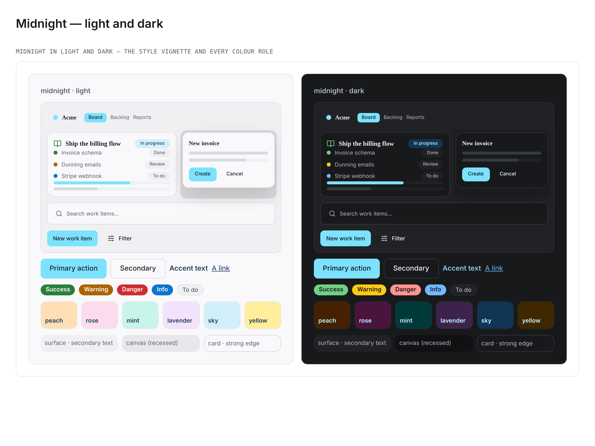

# Palette — Midnight (`data-palette="midnight"`)

> A **dark-first** palette: a cool night-slate ground, a starlight-sky primary and a
> violet highlight. Registered in
> [`packages/design-system/src/theme/palettes.ts`](../../packages/design-system/src/theme/palettes.ts);
> its override lives in the **AXIS 1 (COLOUR)** section of
> [`packages/design-system/theme.css`](../../packages/design-system/theme.css) (which
> `app/globals.css` imports) as the `[data-palette='midnight']` light block plus ONE dark
> companion rule selected by both
> `[data-theme='dark'] [data-palette='midnight']:not([data-theme])` and
> `[data-palette='midnight'][data-theme='dark']`.

**Tagline:** Dark-first and calm — a night-slate ground with a starlight-sky primary and a
violet highlight.
**Inspiration:** A dark-first scheme, every value a documented
[Radix Colors](https://www.radix-ui.com/colors) step (`@radix-ui/colors@3.0.0`): **Slate**
is the night neutral, **Sky** the identity hue, **Purple** the highlight, and **Orange / Pink / Mint / Purple / Sky / Amber / Grass / Blue / Red** supply the
tints and semantics.

## Dark is the source; light is derived

Every palette on the axis before this one was authored twice, once per mode. Midnight is
authored once, in **dark**, and its light mode is **derived** from it: each role takes the
**same Radix step of the light scale of the same ramp** (Slate dark-3 → Slate-3, Sky dark-9 →
Sky-9). Radix makes that a rule rather than a preference: it publishes a light and a dark
scale per hue with the same role per step — 1–2 app backgrounds, 3–5 component
backgrounds, 6–8 borders, 9–10 solid fills, 11–12 text
([understanding the scale](https://www.radix-ui.com/colors/docs/palette-composition/understanding-the-scale),
[composing a palette](https://www.radix-ui.com/colors/docs/palette-composition/composing-a-palette)).
Where the derived value misses a floor, the role departs to another documented step, and
the table names the departure and the measurement that forced it. **Five of the forty
names depart.** No value is a mix of two steps.

### The dark source

A Slate dark-2 page over a Slate dark-1 recessed canvas, Slate dark-3 surfaces, Slate
dark-5/4/6 hairlines, Slate dark-12 ink and dark-11 secondary. The primary fill is Sky
dark-9 `#7ce2fe` under a Sky dark-1 label, and Sky dark-11 `#75c7f0` is the primary as
text. Purple dark-11 is the highlight, the tints are dark-4 washes, and the semantics are
step dark-11. Two element roles are set directly: **In review** takes Sky dark-12
`#c2f3ff` (the primary, Sky dark-11, sits only 8.1 ΔE2000 from the Blue info hue that In
progress rides), and the **logo tile** keeps the shipped dark recipe.

## Derivation table — one row per name the light block declares

| Token                            | Dark (source)                                                           | Dark step                    | Light (derived)           | Light step   | How it was derived                                                                                                                                                                                                                                                                                                                                                                         |
| -------------------------------- | ----------------------------------------------------------------------- | ---------------------------- | ------------------------- | ------------ | ------------------------------------------------------------------------------------------------------------------------------------------------------------------------------------------------------------------------------------------------------------------------------------------------------------------------------------------------------------------------------------------ |
| `--color-primary`                | `#75c7f0`                                                               | Sky dark-11                  | `#1d3e56`                 | Sky-12       | **Departure.** Same-role gives Sky-11 `#00749e`, measured 4.63:1 on the Slate-3 surface and 4.13:1 on the peach tint — under AA as accent text. Sky-12, the ramp's high-contrast text step, is 9.84:1 on the surface.                                                                                                                                                                      |
| `--color-primary-foreground`     | `#0d141f`                                                               | Sky dark-1                   | `#1c2024`                 | Slate-12     | **Departure.** Same-role gives Sky-1 `#f9feff`, 1.07:1 on the Sky-9 fill (Radix publishes step 9 of Sky as the same bright value in both scales, so its label is dark in both). Sky-12 would be legible (7.55:1) but leaves the orb's highlight stop darker than its lit stop (4.92 against 4.94:1), which `orb-glyph-contrast` refuses; the Slate-12 ink is 11.06:1 and keeps that order. |
| `--color-primary-pressed`        | `#a8eeff`                                                               | Sky dark-10                  | `#74daf8`                 | Sky-10       | Same step, light scale.                                                                                                                                                                                                                                                                                                                                                                    |
| `--color-primary-fill`           | `#7ce2fe`                                                               | Sky dark-9                   | `#7ce2fe`                 | Sky-9        | Same step, light scale.                                                                                                                                                                                                                                                                                                                                                                    |
| `--color-background`             | `#18191b`                                                               | Slate dark-2                 | `#f9f9fb`                 | Slate-2      | Same step, light scale.                                                                                                                                                                                                                                                                                                                                                                    |
| `--color-foreground`             | `#edeef0`                                                               | Slate dark-12                | `#1c2024`                 | Slate-12     | Same step, light scale.                                                                                                                                                                                                                                                                                                                                                                    |
| `--color-surface`                | `#212225`                                                               | Slate dark-3                 | `#f0f0f3`                 | Slate-3      | Same step, light scale.                                                                                                                                                                                                                                                                                                                                                                    |
| `--color-surface-soft`           | `#18191b`                                                               | Slate dark-2                 | `#f9f9fb`                 | Slate-2      | Same step, light scale.                                                                                                                                                                                                                                                                                                                                                                    |
| `--color-canvas`                 | `#111113`                                                               | Slate dark-1                 | `#e8e8ec`                 | Slate-4      | **Departure.** Same-role gives Slate-1 `#fcfcfd`, which in light is LIGHTER than the Slate-2 page (1.03:1 the wrong way), so the recess would invert. In dark the canvas is one step under the page; in light the step one under the surface, Slate-4, keeps that recess.                                                                                                                  |
| `--color-ink`                    | `#edeef0`                                                               | Slate dark-12                | `#1c2024`                 | Slate-12     | Same step, light scale.                                                                                                                                                                                                                                                                                                                                                                    |
| `--color-charcoal`               | `#c2f3ff`                                                               | Sky dark-12                  | `#1d3e56`                 | Sky-12       | Same step, light scale.                                                                                                                                                                                                                                                                                                                                                                    |
| `--color-slate`                  | `#b0b4ba`                                                               | Slate dark-11                | `#60646c`                 | Slate-11     | Same step, light scale.                                                                                                                                                                                                                                                                                                                                                                    |
| `--color-steel`                  | `#b0b4ba`                                                               | Slate dark-11                | `#60646c`                 | Slate-11     | Same step, light scale.                                                                                                                                                                                                                                                                                                                                                                    |
| `--color-stone`                  | `#696e77`                                                               | Slate dark-9                 | `#8b8d98`                 | Slate-9      | Same step, light scale.                                                                                                                                                                                                                                                                                                                                                                    |
| `--color-muted`                  | `#212225`                                                               | Slate dark-3                 | `#f0f0f3`                 | Slate-3      | Same step, light scale.                                                                                                                                                                                                                                                                                                                                                                    |
| `--color-muted-foreground`       | `#b0b4ba`                                                               | Slate dark-11                | `#60646c`                 | Slate-11     | Same step, light scale.                                                                                                                                                                                                                                                                                                                                                                    |
| `--color-hairline`               | `#2e3135`                                                               | Slate dark-5                 | `#e0e1e6`                 | Slate-5      | Same step, light scale.                                                                                                                                                                                                                                                                                                                                                                    |
| `--color-hairline-soft`          | `#272a2d`                                                               | Slate dark-4                 | `#e8e8ec`                 | Slate-4      | Same step, light scale.                                                                                                                                                                                                                                                                                                                                                                    |
| `--color-hairline-strong`        | `#363a3f`                                                               | Slate dark-6                 | `#d9d9e0`                 | Slate-6      | Same step, light scale.                                                                                                                                                                                                                                                                                                                                                                    |
| `--color-border`                 | `#2e3135`                                                               | Slate dark-5                 | `#e0e1e6`                 | Slate-5      | Same step, light scale.                                                                                                                                                                                                                                                                                                                                                                    |
| `--color-accent`                 | `#d19dff`                                                               | Purple dark-11               | `#8145b5`                 | Purple-11    | Same step, light scale.                                                                                                                                                                                                                                                                                                                                                                    |
| `--color-accent-orange`          | `#ffca16`                                                               | Amber dark-11                | `#ab6400`                 | Amber-11     | Same step, light scale.                                                                                                                                                                                                                                                                                                                                                                    |
| `--color-accent-teal`            | `#58d5ba`                                                               | Mint dark-11                 | `#027864`                 | Mint-11      | Same step, light scale.                                                                                                                                                                                                                                                                                                                                                                    |
| `--color-accent-green`           | `#71d083`                                                               | Grass dark-11                | `#2a7e3b`                 | Grass-11     | Same step, light scale.                                                                                                                                                                                                                                                                                                                                                                    |
| `--color-tint-peach`             | `#462100`                                                               | Orange dark-4                | `#ffdfb5`                 | Orange-4     | Same step, light scale.                                                                                                                                                                                                                                                                                                                                                                    |
| `--color-tint-rose`              | `#4b143d`                                                               | Pink dark-4                  | `#fbdcef`                 | Pink-4       | Same step, light scale.                                                                                                                                                                                                                                                                                                                                                                    |
| `--color-tint-mint`              | `#003a38`                                                               | Mint dark-4                  | `#c8f4e9`                 | Mint-4       | Same step, light scale.                                                                                                                                                                                                                                                                                                                                                                    |
| `--color-tint-lavender`          | `#3d224e`                                                               | Purple dark-4                | `#f2e2fc`                 | Purple-4     | Same step, light scale.                                                                                                                                                                                                                                                                                                                                                                    |
| `--color-tint-sky`               | `#113555`                                                               | Sky dark-4                   | `#d1f0fa`                 | Sky-4        | Same step, light scale.                                                                                                                                                                                                                                                                                                                                                                    |
| `--color-tint-yellow`            | `#3f2700`                                                               | Amber dark-4                 | `#ffee9c`                 | Amber-4      | Same step, light scale.                                                                                                                                                                                                                                                                                                                                                                    |
| `--color-success`                | `#71d083`                                                               | Grass dark-11                | `#2a7e3b`                 | Grass-11     | Same step, light scale.                                                                                                                                                                                                                                                                                                                                                                    |
| `--color-warning`                | `#ffca16`                                                               | Amber dark-11                | `#ab6400`                 | Amber-11     | Same step, light scale.                                                                                                                                                                                                                                                                                                                                                                    |
| `--color-destructive`            | `#ff9592`                                                               | Red dark-11                  | `#ce2c31`                 | Red-11       | Same step, light scale.                                                                                                                                                                                                                                                                                                                                                                    |
| `--color-destructive-foreground` | `#191111`                                                               | Red dark-1                   | `#fffcfc`                 | Red-1        | Same step, light scale.                                                                                                                                                                                                                                                                                                                                                                    |
| `--color-info`                   | `#70b8ff`                                                               | Blue dark-11                 | `#0d74ce`                 | Blue-11      | Same step, light scale.                                                                                                                                                                                                                                                                                                                                                                    |
| `--color-link`                   | `#70b8ff`                                                               | Blue dark-11                 | `#113264`                 | Blue-12      | **Departure.** Same-role gives Blue-11 `#0d74ce`, 4.19:1 on the Slate-3 surface and 3.74:1 on the peach tint. Blue-12 is the ramp's high-contrast text step.                                                                                                                                                                                                                               |
| `--color-link-pressed`           | `#c2e6ff`                                                               | Blue dark-12                 | `#113264`                 | Blue-12      | Same step, light scale.                                                                                                                                                                                                                                                                                                                                                                    |
| `--el-status-in-review`          | `#c2f3ff`                                                               | Sky dark-12                  | `#1d3e56`                 | Sky-12       | Same step, light scale.                                                                                                                                                                                                                                                                                                                                                                    |
| `--el-logo-tile`                 | `color-mix(in srgb, var(--color-primary) 18%, var(--color-background))` | the shipped dark-base recipe | `var(--color-foreground)` | Slate-12 ink | **Departure.** Same-role would be the 18% wash of the primary over the page; the bright Sky-9 mark measures 1.34:1 on a wash of itself, so the light tile is the palette's ink, `var(--color-foreground)` — Amber's precedent for a bright identity hue.                                                                                                                                   |
| `--el-sidebar-item-bg-hover`     | `#272a2d`                                                               | Slate dark-4                 | `#e8e8ec`                 | Slate-4      | Same step, light scale.                                                                                                                                                                                                                                                                                                                                                                    |

## Distance from its neighbours

Cobalt and Spectrum are the two palettes Midnight sits nearest on the axis. ΔE2000
measured with `deltaE2000` in `tests/theme/colorMetrics.ts` on resolved values:

| Midnight's primary                | mode  | vs Cobalt | vs Spectrum |
| --------------------------------- | ----- | --------- | ----------- |
| fill, `--el-accent` (`#7ce2fe`)   | light | 46.4      | 51.1        |
| fill, `--el-accent` (`#7ce2fe`)   | dark  | 39.8      | 44.0        |
| as text, `--el-accent-on-surface` | light | 16.3      | 18.5        |
| as text, `--el-accent-on-surface` | dark  | 15.3      | 21.7        |

The swatch is the light `--color-primary-fill`, `#7ce2fe` — which, because Radix's Sky-9 is
the same value in both scales, is also the dark fill.

## Accessibility (measured)

Every ratio was measured on resolved values with `tests/theme/colorMetrics.ts` over the
cascade `tests/theme/paletteCascade.ts` models. Every row the style × palette × mode gate
(`tests/theme/stylePaletteModeContrast.test.ts`) records for `midnight` — every registered
style, both modes, every surface the style paints — clears **4.5:1**, with no entry in its
known-failure map.

**Light (derived)**

| Ink                      | page  | card  | surface | surface-soft | canvas | sidebar | lowest tint   |
| ------------------------ | ----- | ----- | ------- | ------------ | ------ | ------- | ------------- |
| `--el-text`              | 15.58 | 15.58 | 14.41   | 15.58        | 13.41  | 14.41   | 12.86 (peach) |
| `--el-text-strong`       | 10.65 | 10.65 | 9.84    | 10.65        | 9.16   | 9.84    | 8.78 (peach)  |
| `--el-text-secondary`    | 5.65  | 5.65  | 5.22    | 5.65         | 4.86   | 5.22    | 4.66 (peach)  |
| `--el-accent-on-surface` | 10.65 | 10.65 | 9.84    | 10.65        | 9.16   | 9.84    | 8.78 (peach)  |
| `--el-link`              | 12.00 | 12.00 | 11.10   | 12.00        | 10.33  | 11.10   | 9.90 (peach)  |

**Dark (source)**

| Ink                      | page  | card  | surface | surface-soft | canvas | sidebar | lowest tint |
| ------------------------ | ----- | ----- | ------- | ------------ | ------ | ------- | ----------- |
| `--el-text`              | 15.15 | 15.15 | 13.70   | 15.15        | 16.25  | 13.70   | 10.87 (sky) |
| `--el-text-strong`       | 14.71 | 14.71 | 13.30   | 14.71        | 15.77  | 13.30   | 10.55 (sky) |
| `--el-text-secondary`    | 8.45  | 8.45  | 7.64    | 8.45         | 9.06   | 7.64    | 6.06 (sky)  |
| `--el-accent-on-surface` | 10.21 | 10.21 | 9.23    | 10.21        | 10.94  | 9.23    | 7.32 (sky)  |
| `--el-link`              | 8.37  | 8.37  | 7.57    | 8.37         | 8.97   | 7.57    | 6.00 (sky)  |

- `--el-accent-text` on `--el-accent` — **11.06:1** light / **12.46:1** dark. Both modes put
  a dark label on the bright Sky-9 fill.
- `--el-danger-text` on `--el-danger` — **5.11:1** / **8.82:1**.
- The canvas is a recess in both modes: Slate dark-1 under the dark-2 page and dark-3
  surface; Slate-4 under the Slate-2 page and Slate-3 surface (the recorded departure).
