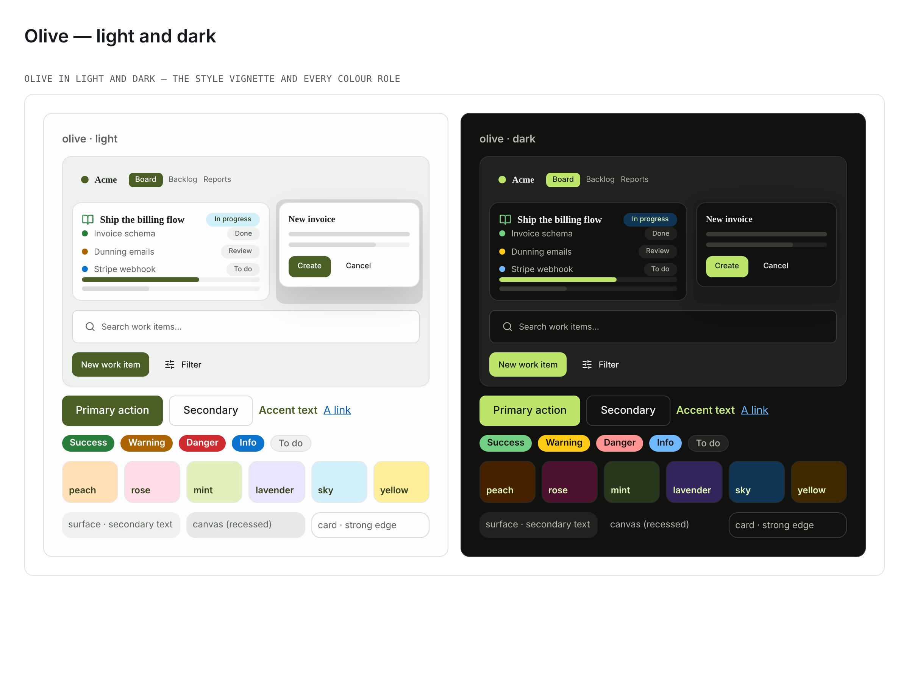

# Palette — Olive (`data-palette="olive"`)

> A muted, **earthy** re-skin: warm green-grey olive neutrals, a moss primary, and a
> terracotta highlight. Registered in
> [`packages/design-system/src/theme/palettes.ts`](../../packages/design-system/src/theme/palettes.ts);
> its override lives in the **AXIS 1 (COLOUR)** section of
> [`packages/design-system/theme.css`](../../packages/design-system/theme.css) (which
> `app/globals.css` imports) as the `[data-palette='olive']` light block plus a dark
> companion selected by both `[data-theme='dark'] [data-palette='olive']:not([data-theme])`
> and `[data-palette='olive'][data-theme='dark']`.

**Tagline:** Muted and earthy — a moss primary over warm olive greys, with a terracotta
highlight.
**Inspiration:** An **olive/earthy concept**, not a single brand — so, as
[Candy](candy.md) and [Lagoon](lagoon.md) do, **every value is a documented
[Radix Colors](https://www.radix-ui.com/colors) step** (`@radix-ui/colors@3.0.0`).
Radix lists **Olive** among its twelve-step neutral families, and its
[palette-composition guidance](https://www.radix-ui.com/colors/docs/palette-composition/composing-a-palette)
designs steps 11 and 12 for low- and high-contrast text. So the neutrals ride **Olive**,
the moss primary rides **Lime** (the yellow-green end of Radix's green family), the
terracotta highlight is **Orange**, the tints are step-4 pastels of **Orange / Crimson /
Lime / Violet / Sky / Amber**, and **Grass / Amber / Red / Blue** carry the semantics.

This is the COLOUR (palette) axis only — picking Olive never changes a radius, a spacing,
a shadow or a font (the independent `data-style` and `data-type` axes).

## How it re-skins

Olive overrides the Tier-0 `--color-*` sources the `--el-*` element layer reads, so
every element token follows; the one element token it sets directly is
`--el-sidebar-item-bg-hover`, declared in **both** modes so the light value cannot
cascade into dark. It sets colour tokens only (`tests/theme/paletteRegistry.test.ts`
enforces the disjointness). No status step is overridden: the moss primary (the
In review hue) sits about 40° of hue from the Grass success family that Done and
Approved derive from, and the status separation suite clears without a move.

## Two derived steps, and why

Radix's step 11 is tuned for a **white** ground. On the Olive-3 section surface, Lime-11
`#5c7c2f` measures **4.22:1**, and on the Orange-4 peach tint **3.76:1** — under AA as
text, and lower again on the material surfaces the styles paint. So the primary is
**Lime-11 mixed 50% toward Lime-12** (`#4a5e26`): still derived from the two Radix steps,
and still a moss rather than the near-black Lime-12 itself. It is 6.33:1 on the surface
and 5.64:1 on the lowest tint. The link takes [Lagoon](lagoon.md)'s **Blue-11 → Blue-12,
65%** step (`#0e5da9`), because Blue-11 alone is 4.20:1 on the surface. Every other value
is a plain Radix step.

## Every value and the step behind it

| Token                            | Light     | Radix step (light)     | Dark      | Radix step (dark)                                     |
| -------------------------------- | --------- | ---------------------- | --------- | ----------------------------------------------------- |
| `--color-primary`                | `#4a5e26` | Lime-11 → Lime-12, 50% | `#bde56c` | Lime dark-11                                          |
| `--color-primary-foreground`     | `#ffffff` | white label            | `#151a10` | Lime dark-2                                           |
| `--color-primary-pressed`        | `#37401c` | Lime-12                | `#d4ff70` | Lime dark-10                                          |
| `--color-primary-fill`           | `#4a5e26` | Lime-11 → Lime-12, 50% | `#bde56c` | Lime dark-11                                          |
| `--color-background`             | `#fcfdfc` | Olive-1                | `#111210` | Olive dark-1                                          |
| `--color-foreground`             | `#1d211c` | Olive-12               | `#eceeec` | Olive dark-12                                         |
| `--color-surface`                | `#eff1ef` | Olive-3                | `#212220` | Olive dark-3                                          |
| `--color-surface-soft`           | `#f8faf8` | Olive-2                | `#181917` | Olive dark-2                                          |
| `--color-canvas`                 | `#e7e9e7` | Olive-4                | `#111111` | Gray dark-1 (Olive has no step below its dark-1 page) |
| `--color-ink`                    | `#1d211c` | Olive-12               | `#eceeec` | Olive dark-12                                         |
| `--color-charcoal`               | `#37401c` | Lime-12                | `#e3f7ba` | Lime dark-12                                          |
| `--color-slate`                  | `#60655f` | Olive-11               | `#afb5ad` | Olive dark-11                                         |
| `--color-steel`                  | `#60655f` | Olive-11               | `#afb5ad` | Olive dark-11                                         |
| `--color-stone`                  | `#898e87` | Olive-9                | `#687066` | Olive dark-9                                          |
| `--color-muted`                  | `#eff1ef` | Olive-3                | `#212220` | Olive dark-3                                          |
| `--color-muted-foreground`       | `#60655f` | Olive-11               | `#afb5ad` | Olive dark-11                                         |
| `--color-hairline`               | `#dfe2df` | Olive-5                | `#2f312e` | Olive dark-5                                          |
| `--color-hairline-soft`          | `#e7e9e7` | Olive-4                | `#282a27` | Olive dark-4                                          |
| `--color-hairline-strong`        | `#d7dad7` | Olive-6                | `#383a36` | Olive dark-6                                          |
| `--color-border`                 | `#dfe2df` | Olive-5                | `#2f312e` | Olive dark-5                                          |
| `--color-accent`                 | `#cc4e00` | Orange-11              | `#ffa057` | Orange dark-11                                        |
| `--color-accent-orange`          | `#ab6400` | Amber-11               | `#ffca16` | Amber dark-11                                         |
| `--color-accent-teal`            | `#008573` | Teal-11                | `#0bd8b6` | Teal dark-11                                          |
| `--color-accent-green`           | `#2a7e3b` | Grass-11               | `#71d083` | Grass dark-11                                         |
| `--color-tint-peach`             | `#ffdfb5` | Orange-4               | `#462100` | Orange dark-4                                         |
| `--color-tint-rose`              | `#fedce7` | Crimson-4              | `#4d122f` | Crimson dark-4                                        |
| `--color-tint-mint`              | `#e2f0bd` | Lime-4                 | `#29371d` | Lime dark-4                                           |
| `--color-tint-lavender`          | `#ebe4ff` | Violet-4               | `#33255b` | Violet dark-4                                         |
| `--color-tint-sky`               | `#d1f0fa` | Sky-4                  | `#113555` | Sky dark-4                                            |
| `--color-tint-yellow`            | `#ffee9c` | Amber-4                | `#3f2700` | Amber dark-4                                          |
| `--color-success`                | `#2a7e3b` | Grass-11               | `#71d083` | Grass dark-11                                         |
| `--color-warning`                | `#ab6400` | Amber-11               | `#ffca16` | Amber dark-11                                         |
| `--color-destructive`            | `#ce2c31` | Red-11                 | `#ff9592` | Red dark-11                                           |
| `--color-destructive-foreground` | `#ffffff` | white label            | `#191111` | Red dark-1                                            |
| `--color-info`                   | `#0d74ce` | Blue-11                | `#70b8ff` | Blue dark-11                                          |
| `--color-link`                   | `#0e5da9` | Blue-11 → Blue-12, 65% | `#70b8ff` | Blue dark-11                                          |
| `--color-link-pressed`           | `#113264` | Blue-12                | `#c2e6ff` | Blue dark-12                                          |
| `--el-sidebar-item-bg-hover`     | `#e7e9e7` | Olive-4                | `#282a27` | Olive dark-4                                          |

## Colour roles

| Role group          | Olive (light → dark)                                                                                         |
| ------------------- | ------------------------------------------------------------------------------------------------------------ |
| Text scale          | Olive ink `#1d211c` + a Lime-12 deep-moss emphasis `#37401c` → Olive-dark `#eceeec` + Lime-dark-12 `#e3f7ba` |
| Accent (CTA)        | moss fill `#4a5e26` with white labels → bright Lime-dark-11 `#bde56c` with dark Lime-dark-2 labels           |
| Surfaces            | warm green-grey Olive-1 / Olive-3 → olive-black Olive-dark-1 / Olive-dark-3                                  |
| Recessed canvas     | Olive-4 `#e7e9e7`, a step under the Olive-3 surface → Gray-dark-1 `#111111`, under the Olive-dark-1 page     |
| Borders             | Olive-5 / Olive-4 / Olive-6 hairlines → Olive-dark-5 / -4 / -6                                               |
| Highlight and links | terracotta Orange-11 highlight; Blue links, apart from the moss primary                                      |
| Semantics           | Grass success, Amber warning, Red danger, Blue info — Radix step 11, brightened to dark-11 in dark           |
| Pastel tints        | `tint-{peach=Orange-4, rose=Crimson-4, mint=Lime-4, lavender=Violet-4, sky=Sky-4, yellow=Amber-4}`           |

**Fill versus label.** In light the **fill** carries the dark value and a white label sits
on it (**7.19:1**); in dark the fill is the bright Lime-dark-11 and the **label** carries
the dark value, Lime-dark-2 (**12.29:1**).

## Olive beside Evergreen

[Evergreen](evergreen.md) is the palette Olive will be confused with — both are green.
They read apart on hue, on lightness and on their neutrals (CIE LCh, measured on the
resolved values):

| role                   | Olive                                   | Evergreen                            |
| ---------------------- | --------------------------------------- | ------------------------------------ |
| primary fill, light    | `#4a5e26` — L 37, C 34, **hue 121°**    | `#0c7a52` — L 45, C 41, **hue 160°** |
| primary fill, dark     | `#bde56c` — L 86, C 63, **hue 120°**    | `#3ddc97` — L 79, C 61, **hue 158°** |
| section surface, light | `#eff1ef` — C 1.2, hue 145°             | `#eef3f0` — C 2.3, hue 159°          |
| section surface, dark  | `#212220` — C 1.5, hue 129° (warm)      | `#141d18` — C 5.9, hue 159° (cool)   |
| highlight              | terracotta Orange-11 `#cc4e00`, hue 52° | —                                    |

Olive's moss sits **about 40° of hue** toward yellow from Evergreen's emerald, and it is
darker and less saturated in light. ΔE2000 between the two resolved `--el-accent` fills
is **16.0** in light and **18.4** in dark. Olive's dark ground is a near-neutral warm
olive-black where Evergreen's is a cool forest green, and the terracotta highlight has
no counterpart in Evergreen.

## Accessibility (measured)

Every ratio below was measured on resolved values with `tests/theme/colorMetrics.ts`
over the cascade `tests/theme/paletteCascade.ts` models. Every row the style × palette ×
mode gate (`tests/theme/stylePaletteModeContrast.test.ts`) records for `olive` — every
registered style, both modes, every surface the style paints — clears **4.5:1**, with no
entry in its known-failure map.

| Ink on its lowest ground (page, card, surface, surface-soft, muted, canvas, sidebar, six tints) | light | dark  |
| ----------------------------------------------------------------------------------------------- | ----- | ----- |
| `--el-text` (primary ink)                                                                       | 12.81 | 10.82 |
| `--el-text-strong` (emphasis / text on tints)                                                   | 8.61  | 10.98 |
| `--el-text-secondary`                                                                           | 4.67  | 6.03  |
| `--el-accent-on-surface`                                                                        | 5.64  | 9.09  |
| `--el-link`                                                                                     | 5.22  | 6.00  |

- `--el-text-secondary` on the section surface — **5.25:1** light / **7.64:1** dark.
- `--el-accent-on-surface` on `--el-tint-lavender` (the ink lint's accent arm) — **5.85:1**
  / **9.72:1**.
- `--el-accent-text` on `--el-accent` — **7.19:1** / **12.29:1**.
- `--el-danger-text` on `--el-danger` — **5.21:1** / **8.82:1**.
- The canvas is a recess in both modes: Olive-4 sits below the Olive-1 page and the Olive-3
  surface; Gray-dark-1 sits below the Olive-dark-1 page and the Olive-dark-3 surface.
